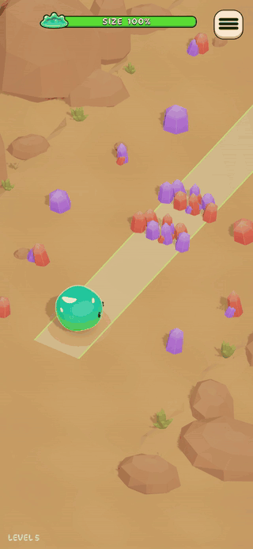
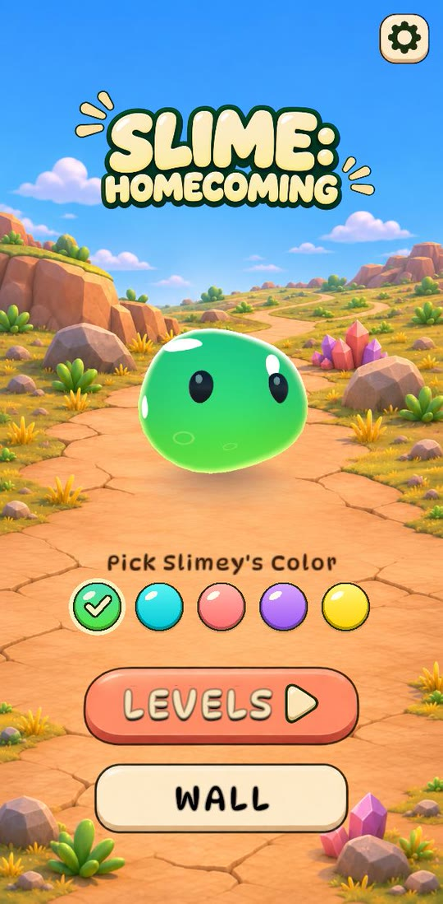
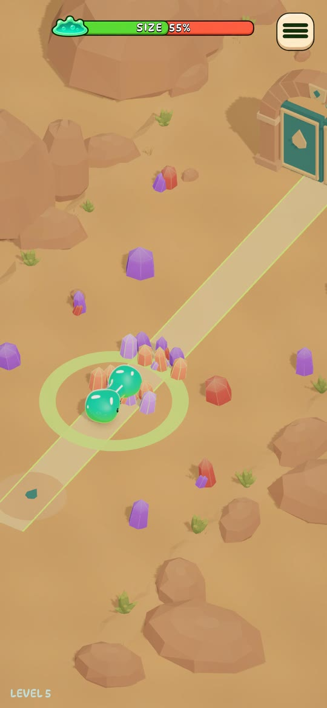
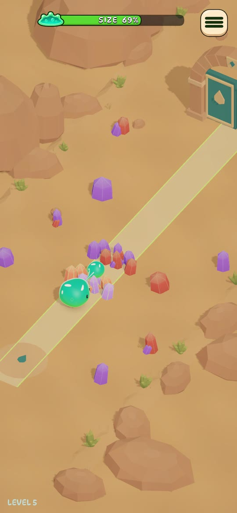
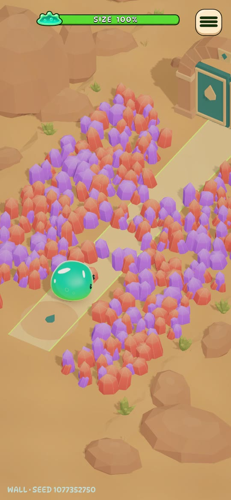
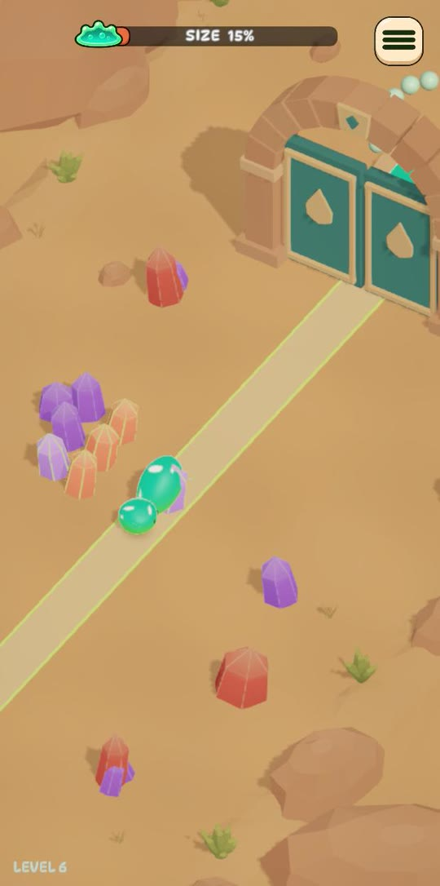
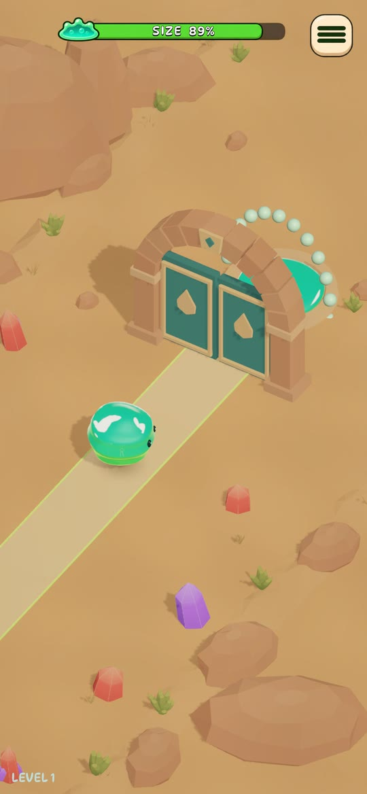
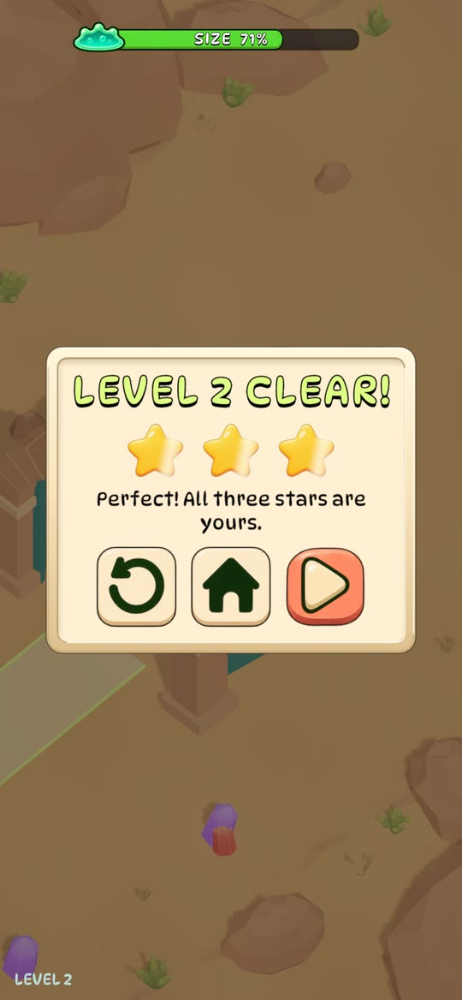
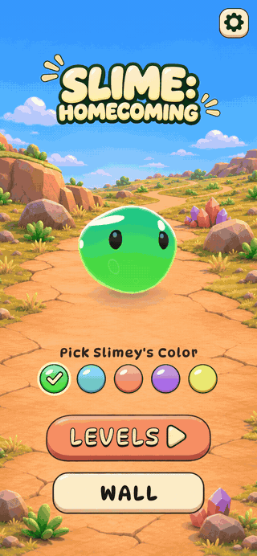
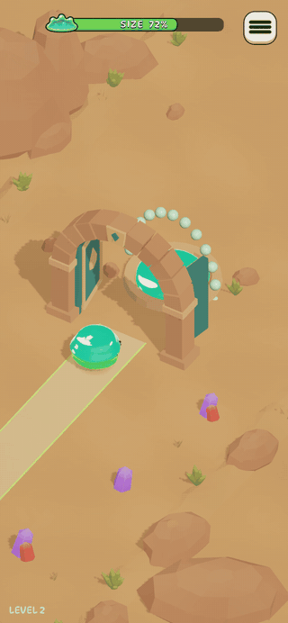

# Slime: Homecoming

A small portrait mobile game made in Unity. A lost slime finds its way home through a canyon full of crystals. The slime has no ammunition, so every shot costs part of its own body. Each shot shrinks the slime, and if it shrinks too far, the run is lost. Clear a path to the colony doors and dive into the pool with your own kind.

> **Strictly non-commercial.** This is a personal, non-commercial project. It is not sold, has no ads or in-app purchases, and must not be used commercially. Some assets, such as music made on the Suno free plan, come with no commercial rights at all.

<p align="center"></p>

## The game

- **Charge and release.** Press and hold anywhere to charge. The slime shrinks and a droplet grows in front of it. The floor shows the blast radius and highlights the crystals that will break. Release to fire. A short tap fires the smallest, cheapest shot.
- **Size is your resource.** A bigger shot clears more, because the blast area grows with the square of its size, but it also costs more of your body. If you overcharge past the critical size, or get stuck without enough size left for another shot, the run is lost.
- **Campaign.** There are 10 hand-designed levels with rising difficulty. Level 1 includes a scripted tutorial. Progress is saved between launches.
- **Stars.** Winning a level earns 1 star. You earn a 2nd star by finishing within the shot limit, and a 3rd by finishing with enough size left. Your best result is saved for each level.
- **Crystal Wall mode.** The whole track is covered in crystals, and each wall is generated from a seed. Every generated wall has been checked by replaying a solution within the size budget. Use **Same wall** to replay a wall and **New wall** to get another one.
- **Endless generator.** This mode gives you a new seeded level on every attempt.
- **4 languages:** English, Spanish, Ukrainian and Simplified Chinese.

| Menu | Charging | Shot | Crystal Wall |
| :---: | :---: | :---: | :---: |
|  |  |  |  |

| Low on size | Doors open | Result |
| :---: | :---: | :---: |
|  |  |  |

## Development time

The game was made over two days, November 8–9, 2026, in about **18 hours** in total:

| Phase | Time |
| --- | --- |
| Planning and documentation (game design document, implementation plan, architecture and code rules) | ~2 h |
| Development (gameplay, content, assets, refactoring, stars, UI polish) | ~16 h |

The game was first built as a complete working prototype and tested on a device. After that, the code was refactored to the documented architecture and code rules. The core rules and generators survived mostly unchanged; the integration, DI and flow layers were rebuilt.

During development, the AI tools listed below produced the assets and the code in parallel with the human direction.

## Tech stack

| | |
| --- | --- |
| Engine | Unity 6000.3.25f1, URP |
| Target | Android (IL2CPP, ARM64), portrait orientation |
| Dependency injection | [VContainer](https://github.com/hadashiA/VContainer) |
| Async | [UniTask](https://github.com/Cysharp/UniTask) |
| Tweens | [DOTween](http://dotween.demigiant.com/) |
| Content | Addressables |
| Text | TextMesh Pro: DynaPuff, Noto Sans and Noto Sans CJK SC fonts |
| Tests | Unity Test Framework (EditMode and PlayMode) |

## Architecture

The game uses MVC on top of DI containers, with three scenes and three container scopes:

```
Loading ──► Menu ──► Game
   │          │        │
ProjectScope (shared services, lives for the whole app)
              MenuScope   GameScope   (exist one at a time)
```

`SceneService` manages every scene transition in the same order. First it shows the crystal loading screen. Then it loads the next scene, waits until that scene's scope is ready, releases the previous scene, and finally reveals the new one. Input stays blocked until the transition finishes.

<p align="center"></p>

<p align="center"><sub>The faint menu buttons showing through the black loading screen are a screen-recorder artefact; the game itself shows a clean black screen.</sub></p>

### Assemblies

Assembly references enforce the feature boundaries, so the boundaries do not depend on convention. Tests also check them.

The [namespace migration report](Docs/NamespaceMigration.md) records the assembly renames and checks that preserve the dependency graph and Unity asset bindings.

| Assembly | Responsibility |
| --- | --- |
| `Slime.Gameplay.Core` | Pure C# rules with no Unity references (`noEngineReferences`). This covers geometry, the attempt model, shot rules, the seeded level and wall generators, and control-plan replay. |
| `Slime.Gameplay.Config` | ScriptableObject configuration for balance, the campaign, the crystal catalog and view tuning. |
| `Slime.Gameplay.View` | Scene views: the slime, crystals, track, doors, impact preview, camera rig, pointer input and `GameClock`. |
| `Slime.Gameplay.Presentation` | The game feature: the gameplay flow, attempt runner, charge input, pause, HUD, results and tutorial. |
| `Slime.Menu` | The menu feature. It does not reference the game feature, and the game feature does not reference it. |
| `Slime.App` | Application services: bootstrap, game launcher, session, progress and preferences, scenes, popups and the loading screen. |
| `Slime.Audio`, `Slime.Infrastructure` | The audio API and its pooled `AudioSource` implementation. |
| `Slime.UI`, `Slime.Localization`, `Slime.Settings`, `Slime.Assets`, `Slime.Foundation` | Shared UI elements, localization, settings, the Addressables wrapper and base utilities. |
| `Slime.Composition` | The only assembly that knows about everything else. It contains `ProjectScope`, `MenuScope` and `GameScope`. |
| `Slime.Diagnostics` | Debug tooling that compiles only with `GAME_DEBUG`: the autopilot, frame recorder and gameplay overrides. |

### Key ideas

- **Level factory.** A `LevelRequest` (`CampaignLevelRequest`, `WallLevelRequest` or `EndlessLevelRequest`) goes to `ILevelFactory`, which picks the matching `ILevelSource`. Seeds come from `ISeedProvider`, so you can reproduce any wall or endless level from its seed.
- **Attempt policies.** Rules that differ by mode, such as progress, retry, the next level, the HUD label and the result buttons, live in one `IAttemptModePolicy` per mode. No controller ever switches on the mode.
- **The model owns the rules, and the view owns the time.** The core model has no timers. Every critical action (impact, clearing, movement, defeat) is a request with an ID. The view plays it as a `UniTask`, and the flow confirms it back to the model only once, and only for the current attempt.
- **One frame pass.** The `GameplayFrame` tick runs all gameplay in a fixed order through VContainer's `ITickable`. Gameplay classes do not use `MonoBehaviour.Update` or coroutines; the camera's `LateUpdate` is the only exception. `GameClock` provides pausable frame waits and animations.
- **Shared shot math.** The charge preview, the shot itself, slime movement and the generator's validator all call the same `ShotRules` functions. So what you see in the preview is exactly what happens.
- **The tutorial is data.** `TutorialScript` describes the steps, `TutorialRunner` plays them, and `SpotlightTargets` resolves what to highlight.
- **Reusable tweens.** All DOTween animations run on reusable `Sequence`s that are built once and replayed, so there is no per-play allocation.
- **Pooled audio.** A fixed pool of voices plays the sounds. The handles use slot versions, so a stale handle can never stop a sound that has reused its slot.

### Code rules

The [`Docs/`](Docs) folder records the conventions, and EditMode tests enforce them:

- No `Update` in gameplay code; frame logic uses `ITickable`.
- Tuning values and localization keys are named constants at the top of the class.
- One statement per line. A guard `return` sits on its own line, followed by a blank line.
- English only in code. Documentation comments go on types only.
- Editor and platform code sits behind `#if`. Information logs compile only with `GAME_DEBUG`.

## Project layout

```
Assets/_Game/
  Gameplay/            Core rules, config, views, editor tools, gameplay tests
  Architecture/        App services: scenes, audio, UI, localization, settings, assets
  ArchitectureIntegration/
    Composition/       DI scopes
    Game/              Game feature (+ Debug/ under GAME_DEBUG)
    Menu/              Menu feature
  Art/ Audio/ Prefabs/ Scenes/ Addressables/
  Tests/               Architecture, style and integration tests
Art/                   Source files for the generated assets (Blender, icons, audio)
Docs/                  Game design, plans, reports, localization tables
```

## Getting started

1. Open the project in **Unity 6000.3.25f1**.
2. Open `Assets/_Game/Scenes/Loading.unity` and press Play. Use a portrait Game View, for example 1080×2340.
3. To build, use **Tools → Ball Game → Build → Android APK**. The build goes to `Builds/Android/UC_BallGame.apk`.

The build command prepares release defines, waits for script compilation, builds Addressables and then builds the ARM64 IL2CPP APK. The regular Unity Build button uses the same preparation. Editor diagnostics return automatically afterwards; no manual `GAME_DEBUG` switch is needed. **Windows Demo Player** builds with development diagnostics for autoplay recordings.

To run the tests:

```bash
unity command test run --mode editor
```

The EditMode suite has 200+ tests. They cover geometry, the model, the generators (run across many seeds), mode policies, assembly boundaries, the frame architecture and code style. The PlayMode suites need `GAME_DEBUG`.

## Room to grow

The game is a complete, playable slice, but it has a lot of room to grow.

- **Bugs and polish.** There are still a couple of small known bugs and a list of polish ideas for game feel, UI and effects.
- **Saves.** Progress, stars, the slime colour and settings are now stored as separate PlayerPrefs keys. Ideally, they would live in one typed, versioned save file. A dedicated save service would serialize and parse that file and migrate old versions, with PlayerPrefs used only as the storage behind it. The same service could also sync the save through the platform stores' cloud saves. The groundwork already exists. `UserService` keeps a typed, versioned user profile (`UserSaveData`). Its file cache writes atomically and keeps a backup copy, and an `IUserRepository` interface is ready for a cloud or store backend. Game progress just needs to move into that profile.
- **Levels as Addressables.** Level and UI assets are deliberately not split into Addressables today: there is no case where the game needs only part of them, so everything loads together. That changes once content ships separately from the app. The infrastructure is already in place: `AssetService` initializes Addressables at bootstrap and hands out reference-counted leases (`AssetLease`), so new content can load and unload through it without new plumbing. All campaign levels now live in one `Campaign.asset`, and the level pipeline is already abstracted behind `ILevelSource`. Storing each level as its own Addressable asset would let levels be added, rebalanced or reordered without touching code, and with a remote catalog, even without a new app build. The [Addressables audit](Docs/AddressablesAudit.md) describes the groundwork.
- **Skins.** The slime already has a colour palette with a saved choice. Skins are the first real case for partial loading: with Addressables, the palette could grow into full skins, with a mesh, materials, effects and sounds in each, loaded only when a player picks one.

## Credits and asset sources

The design and direction are human. Most of the production work was done with AI tools:

| Area | Made with |
| --- | --- |
| 3D models | Built in Blender through the Blender MCP server, driven by **Sol 6.1** |
| UI art | **Sol 6.1** |
| Sound effects | Procedurally generated by **Sol 6.1** |
| Code audit and maintenance | **Claude Opus 5.5**, following the project's documented architecture and code rules |
| Music | **Suno** (free plan) |

Third-party libraries and fonts belong to their authors and keep their own licenses: VContainer, UniTask, DOTween, DynaPuff, Noto Sans and Noto Sans CJK SC (SIL OFL), and Liberation Sans.

<p align="center"></p>

## License and use

This repository is shared for portfolio and learning purposes only. **The game is strictly non-commercial.** You may not sell or monetise it or its generated assets, or use them in commercial products. The music was generated on Suno's free plan, which does not grant commercial rights.
